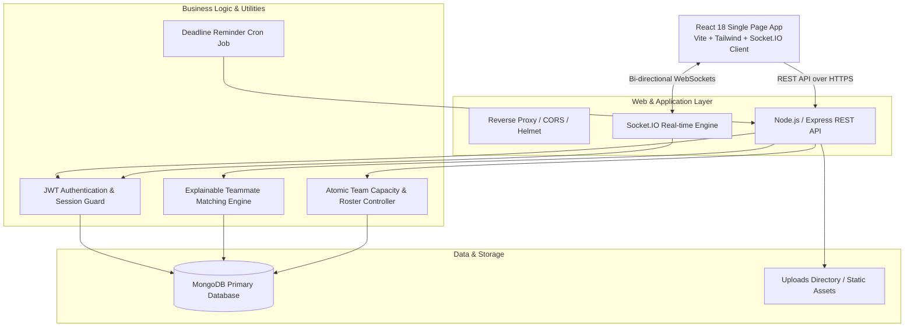
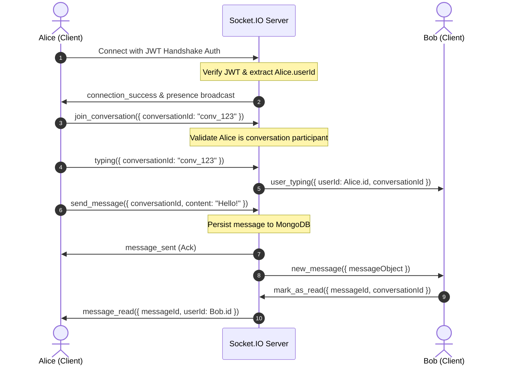

# HackMate System Architecture & Engineering Design

This document details the engineering architecture, real-time communication patterns, explainable recommendation algorithms, and security practices implemented across **HackMate**.

---

## 1. High-Level System Architecture

---

## 2. Explainable Teammate Matching Algorithm

Instead of relying on opaque black-box AI approximations, HackMate implements an **explainable, deterministic weighted heuristic** (`server/src/utils/matchingAlgorithm.js`).

### Compatibility Score Formula:
$$\text{Compatibility Score} = W_s \cdot S_{\text{skills}} + W_r \cdot S_{\text{role}} + W_m \cdot S_{\text{mode}} + W_i \cdot S_{\text{interests}} + W_a \cdot S_{\text{availability}}$$

Where weights are calibrated to hackathon success:
- **Skill Synergy ($W_s = 35\%$)**: Evaluates complementary cross-functional tech stacks (e.g., Frontend React pairing with Backend Python/FastAPI) and common core libraries.
- **Role Complementarity ($W_r = 25\%$)**: Awards maximum points when candidates satisfy unfulfilled roles (e.g., Designer + Full-Stack or AI/ML Engineer).
- **Collaboration Mode Alignment ($W_m = 15\%$)**: Matching remote, hybrid, or in-person preferences.
- **Shared Domain Interests ($W_i = 15\%$)**: Shared passion areas (e.g., AI/Agents, Web3, MedTech, ClimateTech).
- **Availability Overlap ($W_a = 10\%$)**: Weekly commitment bandwidth comparability.

### Transparent Explanations:
For every pair analyzed, the engine produces readable justification bullet points:
- *"Complementary technical skills (Frontend React + Backend Node.js)"*
- *"Shared passion for Autonomous Agents and Fintech"*
- *"Aligned availability (20+ hrs/week commitment)"*

---

## 3. Real-Time Communication Architecture (Socket.IO)

The real-time layer (`server/src/sockets/socketManager.js`) provides immediate message delivery, typing indicators, read receipts, and online presence tracking.

### Room Strategy:
- `user:<userId>`: Scoped room for instant personal notifications, connection alerts, and team invites.
- `conversation:<conversationId>`: Room for conversation messages, reactions, and typing broadcasts.

---

## 4. Team Workspace & Atomic Capacity Management

Concurrent hackathon team applications risk overfilling limited slots. HackMate solves this with **atomic conditions**:
1. When a team owner accepts an application, `findOneAndUpdate` checks `{ _id: teamId, $expr: { $lt: [{ $size: "$members" }, "$desiredSize"] } }`.
2. Open positions are marked `"filled"` within the same transaction/operation.
3. If filled, the application is rejected safely with `400 Team size limit reached`.

---

## 5. Security & Defense in Depth

- **Password Storage**: Passwords salted and hashed with `bcryptjs` (salt rounds: 10).
- **Session Tokens**: Stateless `jsonwebtoken` with 7-day expiration and tamper-proof secret signing.
- **HTTP Protection**:
  - `helmet`: Protects headers against XSS, clickjacking, and MIME-sniffing.
  - `cors`: Restricted to configured client origins.
  - `express-rate-limit`: Rate limiting on auth endpoints (100 requests per 15 minutes).
- **File Upload Safety**:
  - `multer` with file size ceiling (5MB) and strict MIME whitelist (`image/png`, `image/jpeg`, `image/webp`).
  - Stored outside of executable paths with sanitized unique filenames.
- **Data Validation**: Request validation powered by Zod schemas.
- **Audit Logging**: Sensitive actions (role updates, bans, report resolutions) logged to `AuditLog`.
