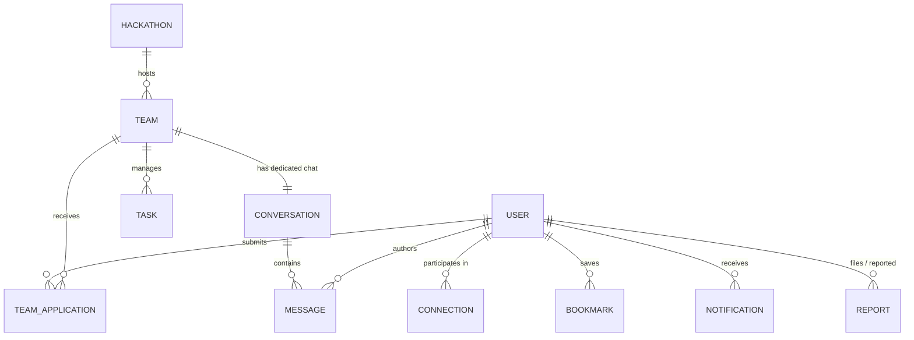

# HackMate Database Architecture & Schema Reference

HackMate uses **MongoDB** with **Mongoose ODM**. The schema architecture is designed for high concurrency, real-time messaging, fast faceted search, and data integrity.

---

## 1. Entity-Relationship Overview



---

## 2. Models Specification

### 2.1 `User` (`server/src/models/User.js`)
Stores developer profiles, credentials, skills, interests, and preferences.
- **Fields**:
  - `fullName`: String (Indexed)
  - `username`: String (Unique, Indexed, Lowercase)
  - `email`: String (Unique, Indexed, Lowercase)
  - `password`: String (bcrypt hash, min length 8)
  - `role`: Enum `['user', 'admin']` (Default `'user'`)
  - `avatar`: String (URL or upload path)
  - `bio`: String (Max 500 chars)
  - `college`: String (Indexed)
  - `primaryRole`: Enum `['Frontend', 'Backend', 'Full-Stack', 'AI/ML', 'UI/UX', 'Mobile', 'DevOps', 'Cybersecurity', 'Blockchain', 'Data Science', 'Product Manager']`
  - `experienceLevel`: Enum `['Beginner', 'Intermediate', 'Advanced']`
  - `skills`: `[String]` (Multikey Index)
  - `interests`: `[String]`
  - `collaborationMode`: Enum `['remote', 'in-person', 'hybrid']`
  - `lookingForTeam`: Boolean (Indexed)
  - `availabilityHoursPerWeek`: Number (Default 20)
  - `location`: String
  - `githubUrl`, `linkedinUrl`, `portfolioUrl`: Strings
  - `profileCompleted`: Boolean
  - `isBanned`: Boolean (Default false)
- **Indexes**:
  - `{ username: 1 }` (Unique)
  - `{ email: 1 }` (Unique)
  - `{ skills: 1, lookingForTeam: 1 }`
  - `{ college: 1, primaryRole: 1 }`

---

### 2.2 `Hackathon` (`server/src/models/Hackathon.js`)
Stores hackathon directories, deadlines, tracks, and prize data.
- **Fields**:
  - `title`: String (Indexed)
  - `slug`: String (Unique)
  - `organizer`: String
  - `description`: String
  - `banner`: String
  - `website`: String
  - `format`: Enum `['online', 'offline', 'hybrid']`
  - `location`: String
  - `startDate`, `endDate`: Dates
  - `registrationDeadline`: Date (Indexed for deadline reminder background jobs)
  - `tracks`: `[String]`
  - `prizes`: `[{ title, amount, description }]`
  - `minTeamSize`: Number (Default 2)
  - `maxTeamSize`: Number (Default 4)
  - `isFeatured`: Boolean (Indexed)
  - `status`: Enum `['upcoming', 'ongoing', 'completed']` (Indexed)

---

### 2.3 `Team` (`server/src/models/Team.js`)
Represents hackathon teams, recruitment parameters, and open roles.
- **Fields**:
  - `name`: String (Indexed)
  - `slug`: String
  - `description`: String
  - `logo`: String
  - `hackathon`: ObjectId -> `Hackathon` (Indexed)
  - `owner`: ObjectId -> `User` (Indexed)
  - `members`: `[{ user: ObjectId -> User, role: String, joinedAt: Date }]`
  - `desiredSize`: Number (Max capacity check: `members.length <= desiredSize`)
  - `recruitmentStatus`: Enum `['open', 'closed']` (Indexed)
  - `collaborationMode`: Enum `['remote', 'in-person', 'hybrid']`
  - `requiredSkills`: `[String]`
  - `problemStatement`: String
  - `openPositions`: `[{ role, requiredSkills, description, status: ['open', 'filled'] }]`
  - `inviteCode`: String (Unique, e.g., `HM-7XK91B`)
  - `conversationId`: ObjectId -> `Conversation`
  - `activityLog`: `[{ action: String, performedBy: ObjectId -> User, timestamp: Date }]`

---

### 2.4 `TeamApplication` (`server/src/models/TeamApplication.js`)
Tracks applications submitted by users to join specific teams.
- **Fields**:
  - `team`: ObjectId -> `Team` (Indexed)
  - `applicant`: ObjectId -> `User` (Indexed)
  - `positionId`: ObjectId
  - `positionRole`: String
  - `message`: String
  - `status`: Enum `['pending', 'accepted', 'rejected', 'withdrawn']` (Indexed)
- **Unique Compound Index**:
  - `{ team: 1, applicant: 1, status: 1 }` (Prevents duplicate active applications)

---

### 2.5 `Connection` (`server/src/models/Connection.js`)
Represents peer-to-peer teammate relationships and requests.
- **Fields**:
  - `requester`: ObjectId -> `User` (Indexed)
  - `recipient`: ObjectId -> `User` (Indexed)
  - `status`: Enum `['pending', 'accepted', 'rejected']` (Indexed)
  - `message`: String
- **Compound Index**:
  - `{ requester: 1, recipient: 1 }` (Unique)

---

### 2.6 `Conversation` & `Message` (`server/src/models/Conversation.js`, `Message.js`)
Powers real-time Socket.IO chat and persistent communication history.
- **`Conversation`**:
  - `type`: Enum `['direct', 'team']` (Indexed)
  - `participants`: `[ObjectId -> User]` (Multikey Index)
  - `team`: ObjectId -> `Team` (Optional)
  - `lastMessage`: ObjectId -> `Message`
  - `updatedAt`: Date (Indexed for sorting active chats)
- **`Message`**:
  - `conversation`: ObjectId -> `Conversation` (Indexed)
  - `sender`: ObjectId -> `User`
  - `content`: String
  - `attachments`: `[{ url, name, size, mimeType }]`
  - `readBy`: `[ObjectId -> User]`
  - `reactions`: `[{ emoji: String, user: ObjectId -> User }]`
  - `replyTo`: ObjectId -> `Message`

---

### 2.7 `Task` (`server/src/models/Task.js`)
Manages the team workspace Kanban board.
- **Fields**:
  - `team`: ObjectId -> `Team` (Indexed)
  - `title`: String
  - `description`: String
  - `status`: Enum `['todo', 'in-progress', 'done']` (Indexed)
  - `priority`: Enum `['low', 'medium', 'high', 'urgent']`
  - `assignee`: ObjectId -> `User`
  - `creator`: ObjectId -> `User`
  - `dueDate`: Date
  - `order`: Number

---

### 2.8 `Notification`, `Bookmark`, `Report`, `AuditLog`
- **`Notification`**: Real-time push + persistent alerts (`type`, `recipient`, `actor`, `title`, `message`, `data`, `isRead`).
- **`Bookmark`**: Saved items for quick access (`user`, `itemType: ['user', 'team', 'hackathon']`, `itemId`).
- **`Report`**: Moderation flags for toxic behavior or spam (`reporter`, `reportedUser`, `reportedTeam`, `reason`, `description`, `status: ['pending', 'resolved', 'dismissed']`).
- **`AuditLog`**: Security compliance events (`actor`, `action`, `targetType`, `targetId`, `ipAddress`, `metadata`).

---

## 3. Concurrency & Integrity Strategies

1. **Atomic Team Capacity Guard**:
   When accepting an application or joining by code:
   ```javascript
   const updated = await Team.findOneAndUpdate(
     { _id: teamId, $expr: { $lt: [{ $size: "$members" }, "$desiredSize"] } },
     { $push: { members: { user: applicantId, role: positionRole, joinedAt: new Date() } } },
     { new: true }
   );
   if (!updated) {
     throw new Error("Team has reached its maximum size limit");
   }
   ```
2. **Duplicate Application Elimination**:
   Database-enforced unique compound indexes eliminate race conditions where a user double-clicks "Apply".
3. **Idempotent Connection Requests**:
   Checked at the query layer and backed by compound indexes `{ requester: 1, recipient: 1 }`.
